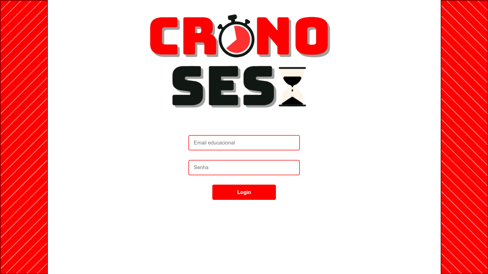
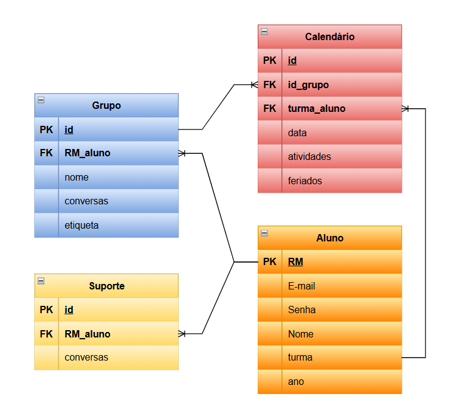
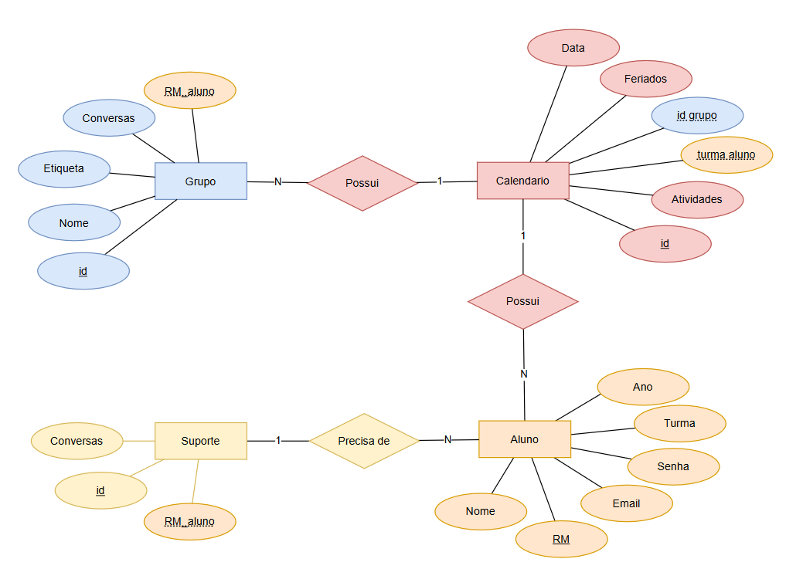

# CRONOSesi - SENAI
Atividade realizada visando obtenção de nota na matéria Projetos do curso de Desenvolvimento de Sistemas - SENAI
## Grupo
- Leandro Imenes de Oliveira
- Heitor Dorigan de Angeli
- Otávio Augusto Barbosa
- Eduardo Moretti Varotti

## Tecnologias Utilizadas
|Tecnologia|Para que foi usada|
|-|-|
|**HTML**|Front-End|
|**CSS**|Estilização do Conteúdo|
|**JavaScript**|Lógica e Back-End|
|**Node.js**|Servidor Back-End|
|**MySQL**|Base de dados|
## O que foi realizado por cada um
|O que realizou|Quem realizou|
|-|-|
|Front-End|Leandro e Otávio|
|Back-End|Heitor|
|Banco de dados e DER|Eduardo|

## Trechos do código
- JavaScript
```JavaScript
const contas = require("./dados.json")

const search = (req, res) => {
    const dados = {"email":req.body.email, "senha":req.body.senha};
    var find = 0;
    var rightPassword = 0;

    const emailEncontrado = contas.find(conta => conta.email === dados.email);

        if(emailEncontrado === undefined){
            console.log("Email não encontrado")
        }else if(emailEncontrado.senha === dados.senha){
            res.redirect("http://127.0.0.1:5500/client/home.html")
            console.log("Login realizado com sucesso")
        }else{ console.log("Senha incorreta")}
    }
module.exports = {
    search
}
```
- HTML
```HTML
    <main class="conteudo-principal">
      <form action="http://localhost:3000/login" method ="post">
        <div class="img">
          
        </div>
        <div class="login">
          <div class="email">
            <input type="text" placeholder="Email educacional" name="email">
          </div>

          <div class="senha">
            <input type="password" placeholder="Senha" name="senha">
          </div>
        </div>
        <div class="botao">
            <button type="submit">Login</button>
        </div>
      </form>
    </main>
```

- CSS
```css
.faixa-esquerda {
  width: 150px;
  background-color: red;
  color: white;
  padding: 20px;
  min-height: 50vh;
  flex-shrink: 0;
  border: 3px solid darkred;
  background-image: repeating-linear-gradient(
    135deg,
    transparent,
    transparent 20px,
    rgba(255, 255, 255, 0.4) 20px,
    rgba(255, 255, 255, 0.4) 23px
    );
}

.faixa-direita {
  width: 150px;
  background-color: red;
  color: white;
  padding: 20px;
  min-height: 50vh;
  flex-shrink: 0;
  border: 3px solid darkred;
  background-image: repeating-linear-gradient(
    45deg,
    transparent,
    transparent 20px,
    rgba(255, 255, 255, 0.4) 20px,
    rgba(255, 255, 255, 0.4) 23px
  );  
}
```

- SQL
```sql
DROP DATABASE if exists cronosesi;
CREATE DATABASE cronosesi;
USE cronosesi;

CREATE TABLE aluno(
    rm int(4) not null primary key,
    nome varchar(100) not null,
    email varchar(100) not null unique,
    senha varchar(10) not null,
    turma varchar(1) not null,
    ano int (2) not null
);

CREATE TABLE calendario(
    id int primary key auto_increment,
    id_grupo int,
    turma_aluno varchar(2) not null,
    data date not null,
    atividades varchar(100),
    feriados varchar(100) not null
);

CREATE TABLE grupo(
    id int not null primary key auto_increment,
    RM_aluno int(4) not null,
    nome varchar(100) not null,
    conversas varchar(100),
    etiqueta enum('Iniciante', 'Mentor') not null
);

CREATE TABLE suporte(
    id int not null primary key auto_increment,
    RM_aluno int(4) not null,
    conversas varchar(100)
);

alter table calendario add constraint id_grupo foreign key (id_grupo) references grupo(id);
alter table grupo add constraint grupo_aluno foreign key (RM_aluno) references aluno(rm);
alter table suporte add constraint suporte_aluno foreign key (RM_aluno) references aluno(rm);

insert into aluno (rm, nome, email, senha, turma, ano) values
(6767, 'Aura Dias', 'aura.dia@gmail.com', password('aura67'), 'A', 2);

select * from aluno;
```

## Prints do site


## Prints do MER DER

